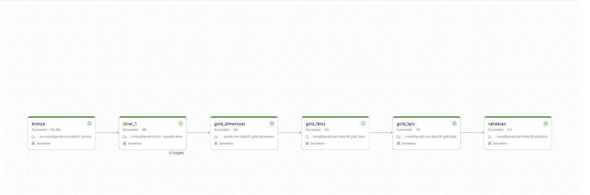
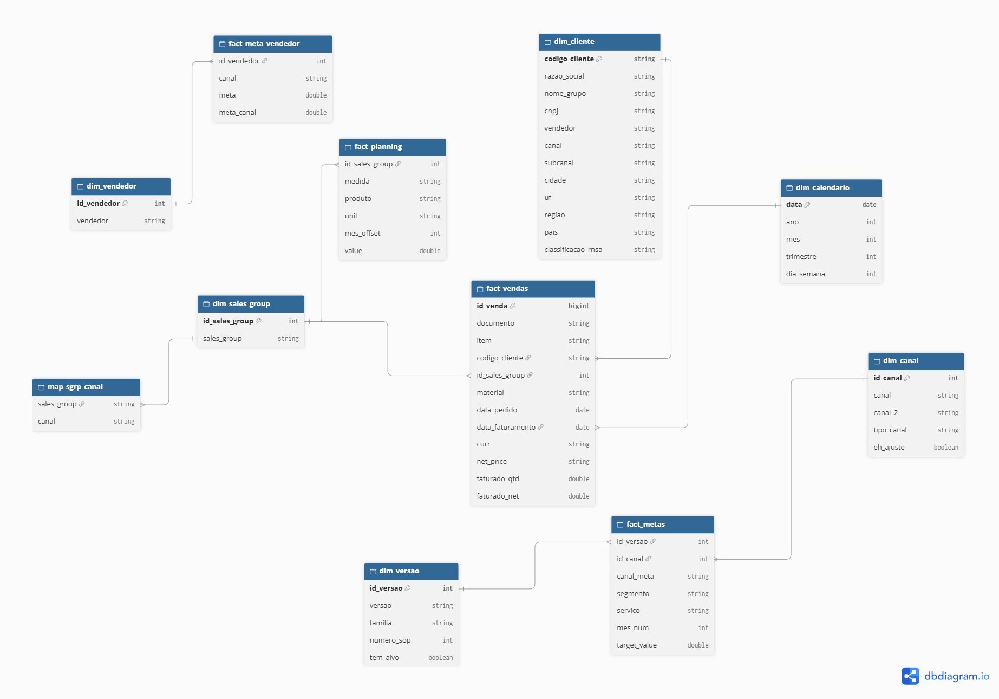

# Medallion Pipeline on Databricks Free Edition

A Bronze → Silver → Gold pipeline built on **anonymized** data from a real sales-reporting project
(13 Excel sources: sales monitoring, targets, planning book, client master). Built to practice data
engineering: ingestion, cleaning, dimensional modeling, data quality gates and orchestration.

## Architecture

| Layer | Schema | What it does |
|---|---|---|
| Bronze | `dsa_projeto.bronze` | One Delta table per `.xlsx`, all columns as text, real nulls preserved, audit columns (`_arquivo_origem`, `_ingestion_timestamp`) |
| Silver | `dsa_projeto.silver` | Typed and cleaned tables (explicit date formats, decimal fixes, trims); bad rows go to quarantine tables |
| Gold | `dsa_projeto.gold` | Star schema (fact constellation) + KPI views |

Stack: Unity Catalog, Volumes, Delta Lake, PySpark, serverless compute, Lakeflow Jobs.

## Gold model

- Dimensions: `dim_cliente`, `dim_vendedor`, `dim_canal`, `dim_versao`, `dim_sales_group`, `dim_calendario`
- Facts: `fact_vendas` (grain: document + item), `fact_metas`, `fact_meta_vendedor`, `fact_planning`
- KPI views: monthly revenue, target attainment by channel, revenue ranking by commercial channel,
  planned vs actual, channel x region distribution
- Keys: deterministic hash keys (`xxhash64`) for dimensions, natural key for clients,
  full 64-bit hash for the fact (a 1-billion range collided: 22 lost IDs in 207k rows), `-1` reserved for unknown members
- Modeling was demand-driven: a KPI catalog defined which tables were needed.

## Data quality

- Every dimension and fact asserts key uniqueness (`exigir_chave_unica`) and fails the task otherwise
- `06_validacao` is a quality gate: unique keys, row counts vs Silver, orphan checks, KPI totals vs fact total
- Quarantine: target rows with Excel errors (`#REF!`) go to `silver.metas_quarentena`
- Quarantine: client rows that fail validation go to `bronze.relacao_de_clientes_quarentena`

## Assumptions and known gaps

- Some client codes in the sales data have no row in the client master (shown as `SEM CADASTRO`)
- Some sales rows have a null `sgrp`; they stay in the fact with no sales group
- `TOTAL` in the planning book is treated as a subtotal and excluded
- `vendedor` in the client master mixes people and categories
- KPI 2 depends on a sales-group → channel mapping that is not in the sources (documented assumption); it uses one fixed target version, year 2026, one goal type, BRL only
- KPI 4 uses measure `Quota` and assumes `m0` = August 2026
- Revenue is never summed across currencies (USD for exports, BRL for the rest)
- Seven Silver tables are not built yet (backlog)

## Notebooks and Job

| Task | Notebook | Depends on |
|---|---|---|
| `bronze` | `01_bronze` | none |
| `silver_1` | `02_silver` (your Silver notebook) | `bronze` |
| `gold_dimensoes` | `03_gold_dimensoes` | `silver_1` |
| `gold_fatos` | `04_gold_fatos` | `gold_dimensoes` |
| `gold_kpis` | `05_gold_kpis` | `gold_fatos` |
| `validacao` | `06_validacao` | `gold_kpis` |

`00_setup` holds shared helpers, loaded with `%run ./00_setup`.
Free Edition allows at most 5 concurrent tasks.

## How to run

1. Create catalog `dsa_projeto` with schemas `bronze`, `silver`, `gold` and a Volume `bronze.arquivos_origem`; upload the `.xlsx` files
2. Import the notebooks into a workspace folder
3. Create a Lakeflow Job with the tasks above and run it
4. Check that `validacao` finishes without exceptions

## Next steps

Auto Loader for incremental files, Genie space and dashboard validated against the original Power BI report,
table descriptions and tags, port to Microsoft Fabric.
